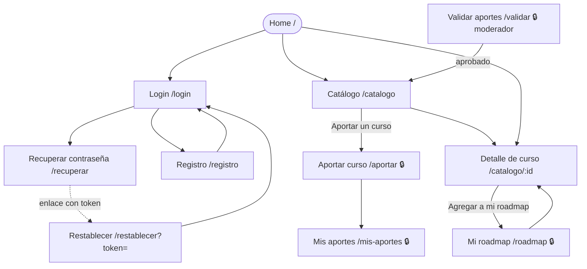

# APPFlow — Mapa del sitio y flujos de usuario — A Cursar

> **Qué es:** el esqueleto de navegación: todas las pantallas con su ruta, qué API consume cada una
> (definida en el [BackendSchema](BackendSchema.md)) y los flujos de punta a punta.
> **Cuándo está bien:** se puede recorrer el producto entero en papel; cada pantalla sabe qué API
> consume y esa API existe en el BackendSchema; no hay pantallas sin ruta ni flujos sin pantallas.

## 1. Sitemap

> 🔒 = requiere sesión. Todas las pantallas comparten el header con menú sándwich (UX-UI §4.5),
> desde el que se llega a cualquier sección según la sesión y el rol.

## 2. Rutas

| Ruta | Pantalla | Requiere login | Notas |
|------|----------|----------------|-------|
| `/` | Home | no | buscador + últimos 6 cursos publicados + CTA "Aportar" |
| `/catalogo` | Catálogo comunitario | no | query params `q`, `categoria`, `modalidad`, `page` (se reflejan en la URL) |
| `/catalogo/:id` | Detalle de curso | no | botón "Agregar a mi roadmap" (pide login si no hay sesión) |
| `/registro` | Registro | no | si ya hay sesión → `/roadmap` |
| `/login` | Login | no | acepta `?volver=<ruta>`; si ya hay sesión → `/roadmap` |
| `/recuperar` | Recuperar contraseña | no | pide email |
| `/restablecer` | Restablecer contraseña | no | `?token=` obligatorio |
| `/aportar` | Aportar curso | sí | |
| `/mis-aportes` | Mis aportes | sí | `?page=` |
| `/roadmap` | Mi roadmap | sí | `?page=` |
| `/validar` | Panel de validación | sí, rol `moderador` | usuario común → pantalla 403 "No tenés permiso" |
| `*` | No encontrado | no | link a Home |

## 3. Fichas de pantalla

### Pantalla: Home (`/`)

- **Objetivo del usuario:** entender de qué se trata y empezar a buscar.
- **Componentes:** header, hero con título + buscador, chips de categorías, grid de 6 cards, CTA "Aportá un curso", skeleton.
- **Estados:** `loading` · `ok` · `empty` (sin cursos: solo hero + CTA) · `error` (banner con reintento).
- **APIs:** `GET /api/v1/cursos?page=1&page_size=6` · `GET /api/v1/categorias`.
- **Navegación:** buscar o tocar una categoría → `/catalogo?q=…` o `?categoria=…`; card → `/catalogo/:id`.

### Pantalla: Catálogo comunitario (`/catalogo`)

- **Objetivo del usuario:** encontrar cursos que le sirvan.
- **Componentes:** buscador, filtros (categoría, modalidad) con "Limpiar", contador "Mostrando X–Y de N", grid de cards, paginador, skeleton, empty state.
- **Estados:** `loading` · `ok` · `empty` (sin resultados) · `error` (reintentar).
- **APIs:** `GET /api/v1/cursos?page=&page_size=12&q=&categoria=&modalidad=` · `GET /api/v1/categorias`.
- **Navegación:** desde Home/menú; hacia Detalle; CTA del empty state → `/aportar`.

### Pantalla: Detalle de curso (`/catalogo/:id`)

- **Objetivo del usuario:** decidir si el curso le sirve y guardarlo.
- **Componentes:** título, chip de categoría, datos (tema, versión, año, docentes, modalidad), badges (cuestionarios, examen, certificado, aval), "El aportante lo tomó: sí/no", botón primario "Ir al curso" (abre la URL en pestaña nueva), botón "Agregar a mi roadmap" / "En tu roadmap", toast.
- **Estados:** `loading` · `ok` · `no encontrado` (404: "Este curso no existe o no está publicado") · `error`.
- **APIs:** `GET /api/v1/cursos/{id}` (incluye `en_mi_roadmap` si hay sesión) · `POST /api/v1/roadmap/items`.
- **Navegación:** sin sesión, "Agregar" → `/login?volver=/catalogo/:id`; después de agregar, el toast ofrece "Ver mi roadmap".

### Pantalla: Registro (`/registro`)

- **Objetivo del usuario:** crear su cuenta.
- **Componentes:** campos nombre, email, contraseña (con mostrar/ocultar), botón "Crear cuenta", link a login.
- **Estados:** `default` · `enviando` · `error de validación` (por campo) · `email duplicado` (409).
- **APIs:** `POST /api/v1/auth/registro` (deja la sesión iniciada).
- **Navegación:** éxito → `/roadmap` con toast "¡Bienvenida/o!".

### Pantalla: Login (`/login`)

- **Objetivo del usuario:** entrar a su cuenta.
- **Componentes:** email, contraseña, botón "Ingresar", links "¿Olvidaste tu contraseña?" y "Crear cuenta".
- **Estados:** `default` · `enviando` · `credenciales inválidas` (401, mensaje genérico) · `bloqueado` (429 "Demasiados intentos, probá en un minuto").
- **APIs:** `POST /api/v1/auth/login`.
- **Navegación:** éxito → `?volver` o `/roadmap`.

### Pantalla: Recuperar contraseña (`/recuperar`)

- **Objetivo del usuario:** recibir un enlace para cambiar la contraseña.
- **Componentes:** email, botón "Enviar enlace", mensaje de confirmación.
- **Estados:** `default` · `enviando` · `enviado` (siempre el mismo mensaje, exista o no el email).
- **APIs:** `POST /api/v1/auth/recuperar`.
- **Navegación:** link "Volver a ingresar" → `/login`.

### Pantalla: Restablecer contraseña (`/restablecer?token=…`)

- **Objetivo del usuario:** definir una contraseña nueva.
- **Componentes:** nueva contraseña, repetir contraseña, botón "Guardar".
- **Estados:** `default` · `enviando` · `token inválido o vencido` (400, link a `/recuperar`) · `éxito`.
- **APIs:** `POST /api/v1/auth/restablecer`.
- **Navegación:** éxito → `/login` con toast "Contraseña actualizada".

### Pantalla: Aportar curso (`/aportar`)

- **Objetivo del usuario:** sumar un curso al catálogo.
- **Componentes:** formulario (URL, categoría, tema, título, versión, año, docentes, modalidad, cuestionarios, examen, certificado, organización que lo avala, "¿Lo tomaste?", "Confirmo que es gratuito"), botón "Enviar a revisión", toast.
- **Estados:** `default` · `enviando` · `errores por campo` (422) · `duplicado` (409, error en el campo URL) · `error de red` (toast, el formulario conserva los datos).
- **APIs:** `GET /api/v1/categorias` · `POST /api/v1/aportes`.
- **Navegación:** éxito → `/mis-aportes` con toast "Aporte enviado a revisión".

### Pantalla: Mis aportes (`/mis-aportes`)

- **Objetivo del usuario:** saber qué pasó con sus aportes.
- **Componentes:** lista de cards con título, fecha y badge de estado; motivo visible si fue rechazado; link al detalle si está publicado; paginador; empty state.
- **Estados:** `loading` · `ok` · `empty` · `error`.
- **APIs:** `GET /api/v1/aportes/mios?page=&page_size=10`.
- **Navegación:** desde el menú o tras aportar; CTA → `/aportar`.

### Pantalla: Mi roadmap (`/roadmap`)

- **Objetivo del usuario:** ver y organizar los cursos que quiere hacer.
- **Componentes:** contador por estado, lista ordenada de ítems (posición, título, badge de estado, select de estado, botones "Subir"/"Bajar", botón "Quitar"), paginador, modal de confirmación, empty state.
- **Estados:** `loading` · `ok` · `empty` ("Tu roadmap está vacío" + "Explorar el catálogo") · `error` · `guardando` (por ítem).
- **APIs:** `GET /api/v1/roadmap?page=&page_size=10` · `PATCH /api/v1/roadmap/items/{id}` · `DELETE /api/v1/roadmap/items/{id}`.
- **Navegación:** título del ítem → `/catalogo/:id`.

### Pantalla: Panel de validación (`/validar`) — solo moderador

- **Objetivo del usuario:** revisar los aportes pendientes y decidir.
- **Componentes:** lista/tabla de aportes `en_revision` (fecha, título, categoría, aportante), panel expandible con todos los datos + link a la URL, botones "Aprobar" y "Rechazar" (modal con motivo), paginador, empty state.
- **Estados:** `loading` · `ok` · `empty` ("No hay aportes pendientes") · `error` · `ya validado` (409: otro moderador lo resolvió → se refresca la lista) · `sin permiso` (403).
- **APIs:** `GET /api/v1/aportes/pendientes?page=&page_size=10` · `POST /api/v1/aportes/{id}/validacion`.
- **Navegación:** solo aparece en el menú si `rol = moderador`.

## 4. Flujos de usuario (mínimo 3)

### Flujo 1 — Aportar un curso al catálogo (US-003)

1. Fany, con sesión iniciada, toca "Aportar curso" en el menú.
2. En `/aportar` el front pide las categorías (`GET /api/v1/categorias`) y muestra el formulario.
3. Completa los datos. Validaciones en el front al salir de cada campo: obligatorios, URL con `http(s)://`, año entre 1990 y el actual.
4. Toca "Enviar a revisión" → `POST /api/v1/aportes`.
5. **201:** toast "Aporte enviado a revisión" y redirección a `/mis-aportes`, donde aparece con badge "En revisión".
6. **Rama 422:** el back devuelve errores por campo → se muestran junto a cada campo y el foco va al primero.
7. **Rama 409 `CURSO_DUPLICADO`:** error en el campo URL "Ese curso ya fue aportado".
8. **Rama sin sesión (401, sesión vencida):** toast "Tu sesión venció", redirección a `/login?volver=/aportar`.

### Flujo 2 — Descubrir un curso y agregarlo al roadmap (US-001, US-005)

1. Fany entra a `/` sin sesión, busca "excel" → `/catalogo?q=excel` (`GET /api/v1/cursos?q=excel&page=1`).
2. Filtra por categoría "Administración y oficina" → la lista vuelve a la página 1.
3. Toca un curso → `/catalogo/12` (`GET /api/v1/cursos/12`).
4. Toca "Agregar a mi roadmap" sin sesión → `/login?volver=/catalogo/12`.
5. Inicia sesión (`POST /api/v1/auth/login`) y vuelve al detalle.
6. Toca "Agregar a mi roadmap" → `POST /api/v1/roadmap/items` → **201**, toast "Agregado a tu roadmap" con acción "Ver".
7. En `/roadmap` cambia el estado a "En curso" → `PATCH /api/v1/roadmap/items/{id}`.
8. **Rama 409 `YA_EN_ROADMAP`:** el botón pasa a "En tu roadmap" (deshabilitado).
9. **Rama 404:** el curso dejó de estar publicado → mensaje "Este curso ya no está disponible".

### Flujo 3 — Validación de un aporte (US-004)

1. Martín inicia sesión; el menú le muestra "Validar aportes".
2. En `/validar` ve los pendientes del más antiguo al más nuevo (`GET /api/v1/aportes/pendientes`).
3. Expande un aporte, abre la URL para comprobar que el curso existe y es gratuito.
4. **Aprobar:** `POST /api/v1/aportes/{id}/validacion` con `{ "aprobado": true }` → 200, toast "Curso publicado"; desaparece de la lista y ya se ve en `/catalogo`.
5. **Rechazar:** abre el modal, escribe el motivo (10–500 caracteres) → `{ "aprobado": false, "motivo": "…" }` → 200; el aportante lo ve en `/mis-aportes`.
6. **Rama 422:** motivo vacío o corto → error en el textarea, el modal sigue abierto.
7. **Rama 409 `APORTE_YA_VALIDADO`:** toast "Este aporte ya fue resuelto" y se recarga la lista.

### Flujo 4 (opcional) — Registro y recuperación de contraseña (US-002, US-006)

1. Un visitante entra a `/registro`, completa nombre, email y contraseña → `POST /api/v1/auth/registro` → 201 con sesión iniciada → `/roadmap` (vacío, con CTA al catálogo).
2. Días después olvida la contraseña: en `/login` toca "¿Olvidaste tu contraseña?" → `/recuperar`.
3. Ingresa su email → `POST /api/v1/auth/recuperar` → 202 y mensaje genérico.
4. El backend genera el token y "envía" el enlace `http://localhost:5173/restablecer?token=…` (en dev, al log del backend).
5. Abre el enlace, define la nueva contraseña → `POST /api/v1/auth/restablecer` → 204 → `/login` con toast.
6. **Rama 400 `TOKEN_INVALIDO`:** token vencido o ya usado → mensaje y link a `/recuperar`.
7. **Rama 429 en login:** después de 5 intentos fallidos en un minuto → "Demasiados intentos, probá en un minuto".

## 5. Estados globales de la app

| Situación | Comportamiento |
|-----------|----------------|
| Al iniciar la app | `GET /api/v1/auth/me`: 200 → sesión cargada en el contexto; 401 → visitante |
| "Cerrar sesión" (menú, cualquier pantalla con sesión) | `POST /api/v1/auth/logout` → 204; se limpia el contexto y redirige a `/` con toast "Cerraste sesión" |
| Sin sesión y ruta protegida | redirect a `/login?volver=<ruta original>` |
| Usuario sin rol moderador en `/validar` | pantalla "No tenés permiso" con link a Home |
| Sesión expirada (401 en cualquier llamada) | se limpia la sesión del contexto, toast "Tu sesión venció" y redirect a `/login?volver=…` |
| Error de red / 500 | toast "No pudimos conectar, reintentá" o banner con "Reintentar" en listados; los formularios conservan lo escrito |
| Ruta inexistente | pantalla 404 con link a Home |

---

**Referencias:**
- NN/g — Information Architecture vs. Sitemaps: https://www.nngroup.com/articles/information-architecture-sitemaps/
- NN/g — User Journeys vs. User Flows: https://www.nngroup.com/articles/user-journeys-vs-user-flows/
