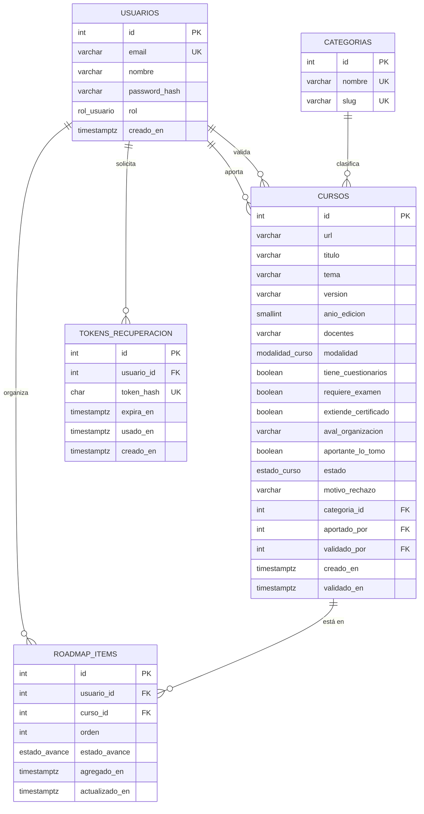
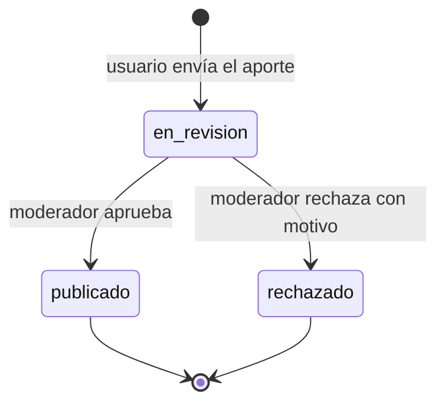

# BackendSchema — Esquema de base de datos y APIs — A Cursar

> **Qué es:** el contrato del backend: modelo de datos en PostgreSQL 18.6 + API REST.
> Cada endpoint que consume una pantalla del [APPFlow](APPFlow.md) está definido acá.
> **Cuándo está bien:** con este documento se puede crear la base y escribir los tests de integración
> sin decisiones pendientes; todo endpoint del APPFlow existe acá con sus respuestas y errores.

## 1. Modelo de datos

### 1.1 Diagrama entidad-relación (Mermaid — se renderiza en GitHub)



### 1.2 Tablas (una por entidad)

#### `usuarios`

| Columna | Tipo | Constraints | Notas |
|---------|------|-------------|-------|
| id | integer identity | PK | |
| email | varchar(50) | NOT NULL, UNIQUE | se guarda en minúsculas |
| nombre | varchar(50) | NOT NULL | |
| password_hash | varchar(60) | NOT NULL | hash bcrypt cost 12, nunca la contraseña en claro |
| rol | rol_usuario | NOT NULL, default `'usuario'` | el moderador se crea por seed |
| creado_en | timestamptz | NOT NULL, default `now()` | |

**Índices:** el UNIQUE de `email` cubre la búsqueda del login.

#### `categorias`

| Columna | Tipo | Constraints | Notas |
|---------|------|-------------|-------|
| id | integer identity | PK | |
| nombre | varchar(60) | NOT NULL, UNIQUE | lista cerrada |
| slug | varchar(60) | NOT NULL, UNIQUE | |

**Seed (lista cerrada):** Programación y tecnología · Administración y oficina · Oficios y construcción ·
Gastronomía · Salud y cuidados · Comercio, ventas y marketing · Idiomas · Diseño y comunicación.

#### `cursos`

Un aporte **es** un curso en estado `en_revision`: aportes y catálogo comparten la tabla y se
distinguen por `estado` (decisión §4).

| Columna | Tipo | Constraints | Notas |
|---------|------|-------------|-------|
| id | integer identity | PK | |
| url | varchar(2048) | NOT NULL | `http://` o `https://`; unicidad parcial (ver índices) — BR-004 |
| titulo | varchar(200) | NOT NULL | |
| tema | varchar(200) | NOT NULL | |
| version | varchar(50) | NOT NULL | ej. "2026", "v2", "1ra edición" |
| anio_edicion | smallint | NOT NULL, CHECK 1990 ≤ x ≤ año actual (validado en service) | BR-009 |
| docentes | varchar(300) | NOT NULL | nombres separados por coma |
| modalidad | modalidad_curso | NOT NULL | campo propio (SPEC §8 #5) |
| tiene_cuestionarios | boolean | NOT NULL | |
| requiere_examen | boolean | NOT NULL | |
| extiende_certificado | boolean | NOT NULL | |
| aval_organizacion | varchar(200) | NULL | NULL = no lo avala ninguna organización |
| aportante_lo_tomo | boolean | NOT NULL | declaración de toma — BR-002 |
| estado | estado_curso | NOT NULL, default `'en_revision'` | ver §2 |
| motivo_rechazo | varchar(500) | NULL; NOT NULL si `estado='rechazado'` (CHECK) | BR-006 |
| categoria_id | integer | NOT NULL, FK → categorias(id) | |
| aportado_por | integer | NOT NULL, FK → usuarios(id) | |
| validado_por | integer | NULL, FK → usuarios(id) | moderador que resolvió |
| creado_en | timestamptz | NOT NULL, default `now()` | |
| validado_en | timestamptz | NULL | también se usa para ordenar el catálogo (más recientes primero) |

**Índices:**
- `UNIQUE (url) WHERE estado <> 'rechazado'` — índice parcial: impide duplicados vivos pero deja
  volver a aportar una URL rechazada (BR-004).
- `(estado, validado_en DESC)` — listado del catálogo y de pendientes.
- `(categoria_id)` y `(modalidad)` — filtros del catálogo.
- `(aportado_por, creado_en DESC)` — "mis aportes".

#### `roadmap_items`

| Columna | Tipo | Constraints | Notas |
|---------|------|-------------|-------|
| id | integer identity | PK | |
| usuario_id | integer | NOT NULL, FK → usuarios(id) ON DELETE CASCADE | dueño — BR-003 |
| curso_id | integer | NOT NULL, FK → cursos(id) | solo cursos `publicado` (validado en service) — BR-007 |
| orden | integer | NOT NULL, CHECK ≥ 1 | posición dentro del roadmap del usuario |
| estado_avance | estado_avance | NOT NULL, default `'pendiente'` | |
| agregado_en | timestamptz | NOT NULL, default `now()` | |
| actualizado_en | timestamptz | NOT NULL, default `now()` | |

**Constraints e índices:** `UNIQUE (usuario_id, curso_id)` (BR-007) · índice `(usuario_id, orden)` para listar ordenado.

#### `tokens_recuperacion`

| Columna | Tipo | Constraints | Notas |
|---------|------|-------------|-------|
| id | integer identity | PK | |
| usuario_id | integer | NOT NULL, FK → usuarios(id) ON DELETE CASCADE | |
| token_hash | char(64) | NOT NULL, UNIQUE | SHA-256 del token; el token en claro solo viaja en el enlace |
| expira_en | timestamptz | NOT NULL | `creado_en + 30 min` |
| usado_en | timestamptz | NULL | se completa al usarlo: un solo uso |
| creado_en | timestamptz | NOT NULL, default `now()` | |

### 1.3 Tipos enumerados

| Tipo | Valores |
|------|---------|
| `rol_usuario` | `usuario`, `moderador` |
| `modalidad_curso` | `presencial`, `semipresencial`, `virtual` |
| `estado_curso` | `en_revision`, `publicado`, `rechazado` |
| `estado_avance` | `pendiente`, `en_curso`, `terminado` |

## 2. Estados del ciclo de vida del curso



| Estado | Quién lo ve | Qué puede pasar |
|--------|-------------|-----------------|
| `en_revision` | el aportante (mis aportes) y los moderadores (pendientes) | aprobar / rechazar (solo moderador, BR-008) |
| `publicado` | todos (catálogo) | agregarse a roadmaps |
| `rechazado` | el aportante, con el motivo | nada; la URL puede volver a aportarse como aporte nuevo |

> No hay estado `borrador`: el formulario se envía completo y entra directo a revisión (PRD §9).

## 3. API REST

**Convención general:**

- Prefijo `/api/v1`; JSON; fechas ISO 8601 UTC.
- **Auth:** cookie httpOnly `acursar_sesion` con JWT (TRD TD-001). "sesión" = requiere cookie válida → si no, 401 `NO_AUTENTICADO`.
- **Paginación (TRD TD-002):** `?page=1&page_size=10` (máx. 50). Respuesta:
  `{ "items": [...], "total": 97, "page": 1, "page_size": 10 }`. Parámetros fuera de rango → 422.
- **Errores (TRD TD-003):** `{ "error": { "code": "...", "message": "...", "details": null } }`.
- `GET /health` → 200 `{ "status": "ok" }` (sin prefijo, para Docker).

### 3.1 Autenticación — dominio `identidad`

| Método | Path | Auth | Request | Respuestas |
|--------|------|------|---------|------------|
| POST | `/api/v1/auth/registro` | pública | `{ "nombre", "email", "password" }` (password ≥ 8) | 201 usuario + cookie · 409 `EMAIL_EN_USO` · 422 |
| POST | `/api/v1/auth/login` | pública, **5/min por IP** | `{ "email", "password" }` | 200 usuario + cookie · 401 `CREDENCIALES_INVALIDAS` · 429 `DEMASIADOS_INTENTOS` · 422 |
| POST | `/api/v1/auth/logout` | sesión | — | 204 (borra la cookie) |
| GET | `/api/v1/auth/me` | sesión | — | 200 usuario · 401 |
| POST | `/api/v1/auth/recuperar` | pública | `{ "email" }` | 202 siempre (no revela si existe) · 422 |
| POST | `/api/v1/auth/restablecer` | pública | `{ "token", "password" }` | 204 · 400 `TOKEN_INVALIDO` (inexistente, vencido o usado) · 422 |

Usuario en respuestas: `{ "id": 3, "nombre": "Fany", "email": "fany@mail.com", "rol": "usuario" }`.

### 3.2 Catálogo de cursos — dominio `cursos`

| Método | Path | Auth | Query / Request | Respuestas |
|--------|------|------|-----------------|------------|
| GET | `/api/v1/cursos` | pública | `page`, `page_size` (default 12), `q` (título o tema, sin distinguir mayúsculas), `categoria` (id), `modalidad` | 200 paginado, solo `publicado`, más recientes primero · 422 |
| GET | `/api/v1/cursos/{id}` | pública (sesión opcional) | — | 200 detalle (con `en_mi_roadmap` si hay sesión) · 404 `CURSO_NO_ENCONTRADO` (inexistente o no publicado) |

Ejemplo `GET /api/v1/cursos?page=1&page_size=2&categoria=2` → 200:

```json
{
  "items": [
    {
      "id": 12,
      "titulo": "Excel inicial para el trabajo",
      "tema": "Planillas de cálculo",
      "categoria": { "id": 2, "nombre": "Administración y oficina" },
      "modalidad": "virtual",
      "docentes": "Ana Pérez",
      "extiende_certificado": true,
      "requiere_examen": true,
      "aval_organizacion": "Municipalidad de La Plata"
    }
  ],
  "total": 7,
  "page": 1,
  "page_size": 2
}
```

Detalle `GET /api/v1/cursos/12`: todos los campos de la tabla salvo `motivo_rechazo` y `validado_por`,
más `aportado_por_nombre` y `en_mi_roadmap` (boolean o `null` sin sesión).

### 3.3 Aportes de cursos y validación — dominio `aportes`

| Método | Path | Auth | Request | Respuestas |
|--------|------|------|---------|------------|
| POST | `/api/v1/aportes` | sesión | ver ejemplo | 201 curso en `en_revision` · 409 `CURSO_DUPLICADO` · 422 (incluye `es_gratuito=false` → `SOLO_CURSOS_GRATUITOS`) |
| GET | `/api/v1/aportes/mios` | sesión | `page`, `page_size` | 200 paginado: `id`, `titulo`, `estado`, `motivo_rechazo`, `creado_en`, `validado_en` |
| GET | `/api/v1/aportes/pendientes` | sesión + rol `moderador` | `page`, `page_size` | 200 paginado de `en_revision`, más antiguos primero, con todos los campos + `aportado_por_nombre` · 403 `SIN_PERMISO` |
| POST | `/api/v1/aportes/{id}/validacion` | sesión + rol `moderador` | `{ "aprobado": true }` o `{ "aprobado": false, "motivo": "…" }` | 200 curso actualizado · 403 · 404 · 409 `APORTE_YA_VALIDADO` · 422 `MOTIVO_REQUERIDO` |

Ejemplo `POST /api/v1/aportes`:

```json
{
  "url": "https://ejemplo.org/cursos/excel-inicial",
  "categoria_id": 2,
  "tema": "Planillas de cálculo",
  "titulo": "Excel inicial para el trabajo",
  "version": "2026",
  "anio_edicion": 2026,
  "docentes": "Ana Pérez",
  "modalidad": "virtual",
  "tiene_cuestionarios": true,
  "requiere_examen": true,
  "extiende_certificado": true,
  "aval_organizacion": "Municipalidad de La Plata",
  "aportante_lo_tomo": true,
  "es_gratuito": true
}
```

> `es_gratuito` no se persiste: es la confirmación obligatoria de BR-005 y debe ser `true`.

### 3.4 Roadmap del usuario — dominio `roadmap`

| Método | Path | Auth | Request | Respuestas |
|--------|------|------|---------|------------|
| GET | `/api/v1/roadmap` | sesión | `page`, `page_size` | 200 paginado por `orden`; cada ítem: `id`, `orden`, `estado_avance`, `curso { id, titulo, categoria, modalidad }` |
| POST | `/api/v1/roadmap/items` | sesión | `{ "curso_id": 12 }` | 201 ítem (al final, `pendiente`) · 404 `CURSO_NO_ENCONTRADO` (inexistente o no publicado) · 409 `YA_EN_ROADMAP` |
| PATCH | `/api/v1/roadmap/items/{id}` | sesión (dueño) | `{ "estado_avance": "en_curso" }` y/o `{ "orden": 1 }` | 200 ítem · 404 (inexistente o de otro usuario) · 422 |
| DELETE | `/api/v1/roadmap/items/{id}` | sesión (dueño) | — | 204 · 404 |

> Un ítem de otro usuario responde 404 (no 403) para no revelar que existe (BR-003).
> Cambiar `orden` mueve el ítem a esa posición y corre los demás (se hace en una transacción).

### 3.5 Categorías (lista cerrada) — dominio `cursos`

| Método | Path | Auth | Respuestas |
|--------|------|------|------------|
| GET | `/api/v1/categorias` | pública | 200 lista completa `[{ "id", "nombre", "slug" }]` — no se pagina: es una lista cerrada de 8 elementos que alimenta selects y filtros |

## 4. Decisiones del esquema

| Decisión | Alternativas | Por qué |
|----------|--------------|---------|
| Aportes y catálogo en **una tabla `cursos`** con `estado` | tabla `aportes` separada que se copia a `cursos` al aprobar | Un solo registro por curso, sin copias que se desincronicen; el estado modela el ciclo de vida directamente |
| Categorías como **tabla** | enum de Postgres / texto libre | Se pueden sumar categorías sin migrar el tipo; FK garantiza la lista cerrada |
| Roadmap como **tabla intermedia** con `orden` y `estado_avance` | array de IDs en `usuarios` | Permite estados, orden, paginación y unicidad por constraint (TRD TD-004) |
| Características (examen, certificado…) como **booleanos** | un JSONB de flags | Se filtran y validan fácil, y son exactamente las que pide la SPEC |
| Docentes como **texto** separado por comas | tabla `docentes` N:M | El MVP no filtra por docente; normalizar queda para cuando se necesite |
| Unicidad de URL con **índice parcial** | UNIQUE simple | Permite reintentar una URL rechazada sin perder el historial del rechazo |
| Token de recuperación **hasheado** | token en claro | Si se filtra la BD, los tokens no sirven |
| `integer identity` como PK | UUID | Simple y suficiente; los ids no son secretos (los roadmaps se protegen por dueño) |

---

**Referencias:**
- Mermaid — Entity Relationship Diagrams: https://mermaid.js.org/syntax/entityRelationshipDiagram.html
- PostgreSQL — The Conceptual Model: https://www.postgresql.org/docs/current/datamodel.html
