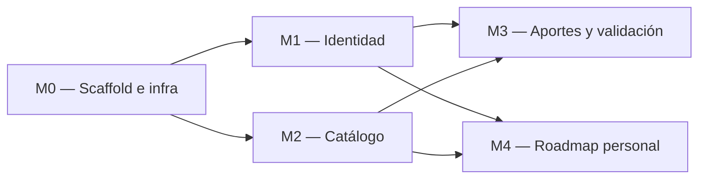

# Implementation Plan — A Cursar

> **Qué es:** el orden de construcción de la Instancia B: módulos, dependencias, tareas con su
> "hecho cuando…" y estimaciones. Cada tarea se hace en su rama según [GIT_WORKFLOW](GIT_WORKFLOW.md).
> **Cuándo está bien:** cada tarea tiene un "hecho" verificable; el orden respeta dependencias reales;
> se puede responder sí o no a "¿el lunes a la noche funciona esto?".

## 1. MVP — qué es P0

> Criterio de MVP: en una máquina limpia, `git clone` → `cp .env.example .env` → `docker compose up`,
> y se recorren de punta a punta desde la UI, sin errores en consola, las historias P0 del [PRD](PRD.md#4-user-stories):

- **US-001** — ver, buscar, filtrar y paginar el catálogo; ver el detalle de un curso.
- **US-002** — registrarse, iniciar sesión (con rate limiting) y cerrar sesión.
- **US-003** — aportar un curso, que queda `en_revision`.
- **US-004** — como moderador, aprobar o rechazar aportes.
- **US-005** — agregar cursos al roadmap, cambiar su estado y quitarlos.
- **US-006** — recuperar la contraseña con el enlace del log del backend.

P1 (solo si sobra tiempo): **US-007** mis aportes · **US-008** reordenar el roadmap.

## 2. Módulos y dependencias (mínimo 4)

- M1 y M2 dependen solo del scaffold: el catálogo es público.
- M3 necesita sesión y rol (M1) y las categorías y el modelo `Curso` (M2).
- M4 necesita sesión (M1) y cursos publicados para agregar (M2).
- Orden de ejecución: **M0 → M1 → M2 → M3 → M4**.

## 3. Detalle por módulo

### M0 — Scaffold e infraestructura · rama `chore/scaffold`

| # | Tarea | Hecho cuando… | Estimación |
|---|-------|----------------|------------|
| 0.1 | Estructura de carpetas del TRD §3.2 + `.env.example` | el árbol existe en el repo y `.env.example` tiene todas las variables del TRD §4 | 1 h |
| 0.2 | `docker-compose.yml` con postgres 18.6 + volumen | `docker compose up postgres` levanta y `pg_isready` responde OK | 1 h |
| 0.3 | Backend FastAPI con uv, Dockerfile, `compartido/` (db, errores, paginación) y `GET /health` | `curl localhost:8000/health` → 200 `{"status":"ok"}` dentro del compose | 2 h |
| 0.4 | Frontend Vite + React 19 con pnpm, Dockerfile, Tailwind CSS 4 con los tokens en `@theme` (`index.css`), layout con Header y menú sándwich, router con todas las rutas del APPFlow (placeholders) | `docker compose up` muestra el shell en `localhost:5173`; en 360px se ve la hamburguesa y el drawer abre y cierra con ESC | 2,5 h |
| 0.5 | Proxy `/api` de Vite al backend + cliente `api/cliente.js` con manejo del envelope de error | desde el front, `fetch('/api/v1/...')` llega al backend | 1 h |

### M1 — Identidad · rama `feature/US-002-identidad`

| # | Tarea | Hecho cuando… | Estimación |
|---|-------|----------------|------------|
| 1.1 | Modelos `Usuario` y `TokenRecuperacion` + bcrypt (cost 12) + JWT en cookie httpOnly | al registrar un usuario, `password_hash` empieza con `$2b$12$` | 1,5 h |
| 1.2 | `POST /auth/registro`, `/auth/login`, `/auth/logout`, `GET /auth/me` | con `curl`: registro → 201 y cookie; `me` con cookie → 200; email repetido → 409 | 2 h |
| 1.3 | Rate limiting en login con slowapi (5/min por IP) | el 6° `POST /auth/login` en un minuto → 429 `DEMASIADOS_INTENTOS` | 1 h |
| 1.4 | `POST /auth/recuperar` y `/auth/restablecer` + notificador por log | el enlace aparece en `docker compose logs backend`; usarlo cambia la contraseña; reusarlo → 400 | 1,5 h |
| 1.5 | Pantallas Login, Registro, Recuperar, Restablecer + contexto de sesión + `RutaProtegida` | se recorre US-002 y US-006 desde la UI; `/roadmap` sin sesión redirige a `/login?volver=/roadmap` | 2,5 h |
| 1.6 | Seed de usuarios demo (moderador y usuario) | `moderador@acursar.local` y `usuario@acursar.local` pueden iniciar sesión tras `docker compose up` | 30 min |

### M2 — Catálogo comunitario · rama `feature/US-001-catalogo`

| # | Tarea | Hecho cuando… | Estimación |
|---|-------|----------------|------------|
| 2.1 | Modelos `Categoria` y `Curso` (enums, índice parcial de URL) + seed de 8 categorías y 15 cursos publicados | al levantar hay 15 cursos publicados en 6+ categorías | 2 h |
| 2.2 | `GET /cursos` paginado con `q`, `categoria`, `modalidad` + `GET /categorias` | `curl '/api/v1/cursos?page=2&page_size=5'` → `total: 15`, 5 items; un curso `en_revision` nunca aparece | 1,5 h |
| 2.3 | `GET /cursos/{id}` con `en_mi_roadmap` | publicado → 200; `en_revision` o inexistente → 404 | 1 h |
| 2.4 | Componentes `CardCurso`, `Paginador`, `Skeleton`, `EmptyState` | se ven según UX-UI §4 en 360px y 1024px | 2 h |
| 2.5 | Pantallas Home, Catálogo (filtros + paginación en la URL) y Detalle | se recorre US-001 desde la UI; recargar `/catalogo?page=2&q=excel` mantiene el estado | 2,5 h |

### M3 — Aportes y validación · rama `feature/US-003-aportes-validacion`

| # | Tarea | Hecho cuando… | Estimación |
|---|-------|----------------|------------|
| 3.1 | `POST /aportes` con validaciones (BR-002, BR-004, BR-005, BR-009) | aporte válido → 201 `en_revision`; URL repetida → 409; `es_gratuito=false` → 422 | 1,5 h |
| 3.2 | `GET /aportes/pendientes` y `POST /aportes/{id}/validacion` con dependencia `requiere_moderador` | usuario común → 403; aprobar → aparece en `GET /cursos`; rechazar sin motivo → 422; validar dos veces → 409 | 1,5 h |
| 3.3 | Pantalla Aportar curso (formulario + errores por campo) | se recorre US-003 desde la UI; los errores del back se muestran junto a cada campo | 2,5 h |
| 3.4 | Pantalla Panel de validación con modal de rechazo; ítem del menú solo para moderador | se recorre US-004 desde la UI con el usuario moderador del seed | 2,5 h |
| 3.5 | *(P1)* `GET /aportes/mios` + pantalla Mis aportes | US-007: el aportante ve el badge y el motivo de rechazo | 1,5 h |

### M4 — Roadmap personal · rama `feature/US-005-roadmap`

| # | Tarea | Hecho cuando… | Estimación |
|---|-------|----------------|------------|
| 4.1 | Modelo `RoadmapItem` + `POST /roadmap/items`, `GET /roadmap`, `PATCH` (estado), `DELETE` | con `curl`: agregar → 201; repetir → 409; curso no publicado → 404; ítem ajeno → 404 | 2 h |
| 4.2 | Botón "Agregar a mi roadmap" en Detalle (con redirección a login sin sesión) | desde el detalle se agrega y el botón pasa a "En tu roadmap" | 1 h |
| 4.3 | Pantalla Mi roadmap: lista paginada, cambio de estado, quitar con confirmación, empty state | se recorre US-005 desde la UI | 2,5 h |
| 4.4 | *(P1)* Reordenar con "Subir"/"Bajar" (`PATCH orden`) | US-008: el orden se mantiene al recargar | 1,5 h |

### Cierre · rama `docs/readme-instancia-b`

| # | Tarea | Hecho cuando… | Estimación |
|---|-------|----------------|------------|
| 5.1 | README con instrucciones verificables (comandos, URLs, usuarios demo) y este plan con `[x]` y ramas | en un clon limpio, siguiendo el README se recorren las 6 historias P0 | 1 h |

**Total estimado P0:** ≈ 40 h · **P1:** ≈ 3 h.

> **Criterio de estimación:** tiempos de un desarrollador junior que trabaja solo, aprende parte del stack
> sobre la marcha (FastAPI, SQLModel, JWT, Tailwind 4) y necesita leer documentación y depurar. Se tomó
> la estimación de un desarrollador con experiencia y se multiplicó por 2,5, redondeando a bloques de 30 min.
> Al cerrar cada módulo se compara el tiempo real con el estimado y se ajustan los módulos siguientes.

## 4. Ejecución (Instancia B)

> **Regla:** 1 módulo = 1 rama (`chore/…`, `feature/US-…`) desde `develop` con commits convencionales por tarea, mergeada
> a `develop` por Pull Request según GIT_WORKFLOW §4. Se actualiza esta tabla al terminar cada tarea.

| # | Tarea | Módulo | Estado | Rama / Commit |
|---|-------|--------|--------|---------------|
| 0.1 | Estructura de carpetas + `.env.example` | M0 | [ ] | `chore/scaffold` |
| 0.2 | docker-compose postgres | M0 | [ ] | `chore/scaffold` |
| 0.3 | Backend mínimo + `/health` | M0 | [ ] | `chore/scaffold` |
| 0.4 | Frontend shell + menú sándwich + rutas | M0 | [ ] | `chore/scaffold` |
| 0.5 | Proxy `/api` + cliente | M0 | [ ] | `chore/scaffold` |
| 1.1 | Modelos + bcrypt + JWT | M1 | [ ] | `feature/US-002-identidad` |
| 1.2 | Registro, login, logout, me | M1 | [ ] | `feature/US-002-identidad` |
| 1.3 | Rate limiting | M1 | [ ] | `feature/US-002-identidad` |
| 1.4 | Recuperación de contraseña | M1 | [ ] | `feature/US-002-identidad` |
| 1.5 | Pantallas de identidad | M1 | [ ] | `feature/US-002-identidad` |
| 1.6 | Seed de usuarios | M1 | [ ] | `feature/US-002-identidad` |
| 2.1 | Modelos + seed de catálogo | M2 | [ ] | `feature/US-001-catalogo` |
| 2.2 | `GET /cursos` + `/categorias` | M2 | [ ] | `feature/US-001-catalogo` |
| 2.3 | `GET /cursos/{id}` | M2 | [ ] | `feature/US-001-catalogo` |
| 2.4 | Componentes de listado | M2 | [ ] | `feature/US-001-catalogo` |
| 2.5 | Pantallas Home, Catálogo, Detalle | M2 | [ ] | `feature/US-001-catalogo` |
| 3.1 | `POST /aportes` | M3 | [ ] | `feature/US-003-aportes-validacion` |
| 3.2 | Pendientes + validación | M3 | [ ] | `feature/US-003-aportes-validacion` |
| 3.3 | Pantalla Aportar | M3 | [ ] | `feature/US-003-aportes-validacion` |
| 3.4 | Pantalla Validar | M3 | [ ] | `feature/US-003-aportes-validacion` |
| 3.5 | *(P1)* Mis aportes | M3 | [ ] | `feature/US-003-aportes-validacion` |
| 4.1 | API de roadmap | M4 | [ ] | `feature/US-005-roadmap` |
| 4.2 | Botón agregar en Detalle | M4 | [ ] | `feature/US-005-roadmap` |
| 4.3 | Pantalla Mi roadmap | M4 | [ ] | `feature/US-005-roadmap` |
| 4.4 | *(P1)* Reordenar | M4 | [ ] | `feature/US-005-roadmap` |
| 5.1 | README de la Instancia B | — | [ ] | `docs/readme-instancia-b` |

## 5. Estrategia de testing

> Se **planifica** acá y se **implementa** en la clase del 27/10.

- **Unit tests (services, pytest):** reglas puras — validación de aportes (BR-002, BR-004, BR-005, BR-009),
  transiciones de estado del curso (BR-008, motivo obligatorio BR-006), reglas del roadmap (BR-007,
  reordenamiento), vencimiento y un solo uso del token de recuperación. Patrón AAA, repositorios falsos.
- **Integration tests (pytest + httpx `TestClient`):** contra el Postgres del compose en una base de test;
  un test por endpoint con su caso feliz y sus errores (401/403/404/409/422/429).
- **Frontend (Vitest + Testing Library):** hook de paginación, hook de sesión, formulario de aporte
  (errores por campo) y menú sándwich (abre, cierra con ESC, `aria-expanded`).
- **Objetivo de cobertura:** ≥ 85% en `service.py`; ≥ 70% en el backend total.

## 6. Riesgos del plan

| Riesgo | Impacto | Mitigación |
|--------|---------|------------|
| Poco tiempo entre la aprobación y el cierre de la Instancia B | alto | Solo P0, en el orden del grafo; P1 queda marcado como pendiente sin bloquear el MVP |
| La cookie de sesión no viaja entre front y back | alto | Proxy de Vite (mismo origen) probado en la tarea 0.5, antes de M1 |
| El formulario de aporte (14 campos) lleva más de lo estimado | medio | Un único schema Pydantic como fuente de verdad; el front muestra `details` del 422 sin duplicar reglas |
| El seed no corre o duplica datos al reiniciar | medio | Seed idempotente (inserta solo si la tabla está vacía) |
| Diferencias de entorno entre mi máquina y una limpia | alto | Probar el README desde un `git clone` nuevo antes de entregar (tarea 5.1) |

---

**Referencias:**
- Atlassian — Plantilla de plan de proyecto: https://www.atlassian.com/software/confluence/templates/project-plan
- Shape Up: https://basecamp.com/shapeup/
